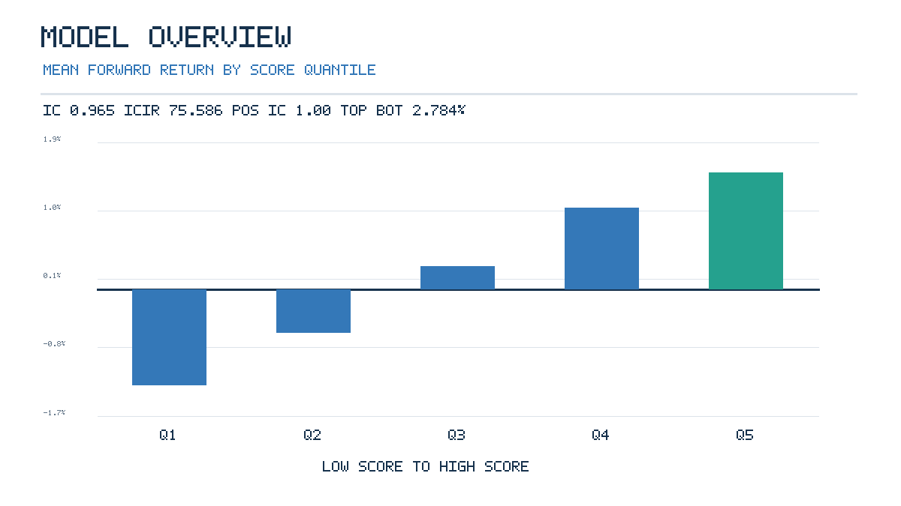
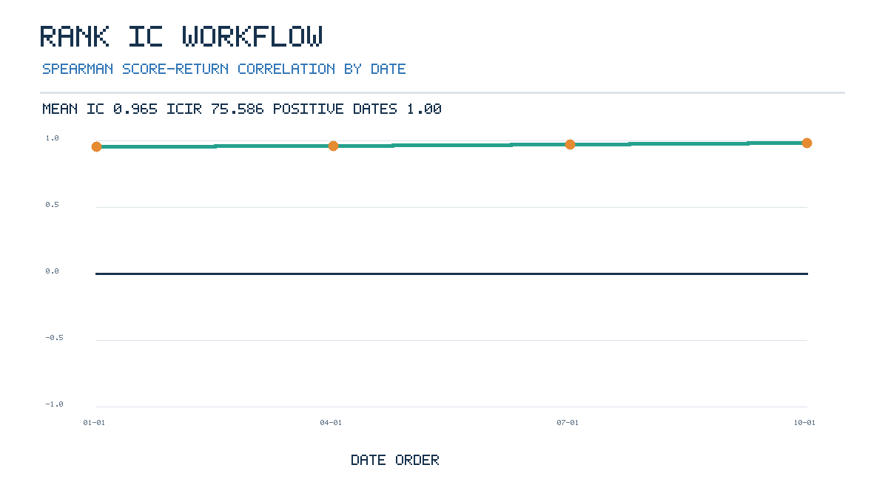

# Transparent Cross-Sectional Equity Model

A small, reproducible research exercise that ranks synthetic securities using equally weighted value, momentum, and quality signals, then evaluates next-period returns by score quantile and calculates rank information coefficients (IC).

## Quick start

From this directory, using Python 3.10+:

```sh
PYTHONPATH=src /opt/homebrew/bin/python3 -m cross_sectional --data data/cross_sectional.csv
PYTHONPATH=src /opt/homebrew/bin/python3 -m unittest discover -s tests -v
```

The CLI prints and saves a JSON summary to `data/metrics.json` by default. Use `--output results.json` to change the output path, `--quantiles 5` to change the number of groups, or `--data path/to/file.csv` to analyze another compatible dataset. Expected columns are `date,security,value,momentum,quality,forward_return`.

Regenerate the checked-in synthetic data or the chart assets with `PYTHONPATH=src /opt/homebrew/bin/python3 scripts/generate_sample_data.py` and `PYTHONPATH=src /opt/homebrew/bin/python3 scripts/generate_reports.py`, respectively.

## Method

Within each date, each input signal is standardized across securities using the population mean and standard deviation. The composite score is the arithmetic mean of the three z-scores. Securities are sorted by score (ties broken by security identifier) and split into as-even-as-possible ascending quantiles. The top quantile is the highest-score group. Quantile returns are arithmetic means of the supplied forward returns. Daily rank IC is Spearman correlation between composite score and forward return.

The summary now includes mean and sample standard deviation of daily rank IC, IC information ratio, positive-IC date fraction, per-quantile mean/dispersion/positive-date fraction, and the date-level top-minus-bottom return mean, dispersion, and positive-date fraction. Both chart screenshots display key IC and spread diagnostics as well as their chart. These are synthetic descriptive metrics with no transaction-cost or statistical-significance adjustment.

The included CSV has deterministic, hand-designed synthetic signals and outcomes spanning several fictional rebalance dates. It exists only to demonstrate the calculations.

## Assumptions and limitations

- Signals are assumed to be available at ranking time, and `forward_return` is assumed to be measured strictly after that time. The example does not model publication lags, revisions, survivorship, delistings, or point-in-time universes.
- Inputs are already numeric and suitably cleaned. Missing values, duplicate security/date rows, or non-finite values are rejected rather than imputed.
- Equal-weight signal combination, per-date z-scoring, equal-weight quantile portfolios, and arithmetic return aggregation are illustrative choices, not optimized prescriptions.
- No transaction costs, turnover, liquidity, portfolio constraints, taxes, financing, or execution effects are modeled. Quantile results and IC are descriptive in-sample statistics, not evidence of predictability.
- All securities, signals, and returns are fictional. Nothing here is investment advice or a real-return claim.

## Included chart assets

### Project overview — mean forward return by score quantile



### Workflow — date-by-date rank information coefficient



Both white-background charts are supplied as SVG and PNG in `reports/`.
